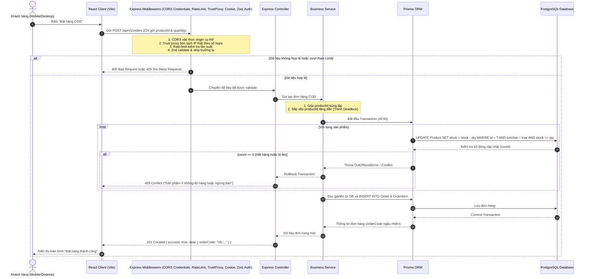

# TÀI LIỆU KIẾN TRÚC HỆ THỐNG (ARCHITECTURE)
## Dự án: Website Điện Máy VietElectro

---

## 1. Công nghệ Đề xuất & Quyết định Kỹ thuật

Hệ thống lựa chọn ngăn xếp công nghệ tinh gọn, ổn định và hiệu năng cao:

| Thành phần | Công nghệ lựa chọn | Lý do & Quyết định kỹ thuật |
| :--- | :--- | :--- |
| **Frontend** | **React 18+ (Vite) + TypeScript** | Build cực nhanh với Vite, bundling tối ưu cho mobile-first. TypeScript giúp đồng bộ kiểu dữ liệu với backend, giảm thiểu lỗi runtime. |
| **Styling** | **CSS Modules kết hợp Vanilla CSS Custom Properties (Design Tokens)** | **Quyết định kỹ thuật**: Sử dụng CSS Modules kết hợp CSS Variables dùng chung.<br/>- *Zero configuration*: Vite hỗ trợ `.module.css` mặc định, không cần cài PostCSS plugins phức tạp.<br/>- *Scoped CSS tự động*: Tránh 100% nguy cơ xung đột class name giữa các component độc lập.<br/>- *Quản lý Design System tập trung*: Tận dụng CSS Variables (Design Tokens) cho màu sắc, typography và khoảng cách nhất quán trên toàn ứng dụng.<br/>- *Dễ bảo trì UI phức tạp*: Phù hợp viết và tinh chỉnh các thành phần e-commerce đặc thù (Mega menu đa tầng, drawer giỏ hàng, animations). |
| **Backend** | **Node.js + Express + TypeScript** | Khung sườn kinh điển, hiệu năng cao, cơ chế middleware linh hoạt, thời gian khởi động nhanh, dễ bảo trì và mở rộng. |
| **Cơ sở dữ liệu** | **PostgreSQL (v15+)** | CSDL quan hệ chuẩn công nghiệp, hỗ trợ ACID toàn vẹn cho đơn hàng và giao dịch tồn kho, hỗ trợ ràng buộc CHECK ở tầng DB. |
| **ORM** | **Prisma ORM** | Type-safe 100% từ Database schema đến mã TypeScript, quản lý migration rõ ràng, hỗ trợ interactive transactions tin cậy. |
| **Kiểm tra dữ liệu**| **Zod** | Validate dữ liệu đầu vào nghiêm ngặt tại Controller server; áp dụng `.strip()` để tự động loại bỏ mọi trường lạ (đặc biệt là `role`). Không tin bất kỳ dữ liệu nào từ client. |
| **Xác thực** | **JWT lưu trong Cookie httpOnly** | Ngăn chặn đánh cắp token qua XSS. Mật khẩu tối thiểu 8 ký tự, băm bằng **Argon2** (hoặc Bcrypt). |
| **Testing** | **Vitest + Supertest + Playwright** | Vitest cho Unit Test logic; Supertest cho Integration API; Playwright kiểm thử E2E trên mobile giả lập. |

---

## 2. Cấu trúc Thư mục Dự án (Directory Structure)

Dự án được tổ chức theo mô hình Monorepo chia làm `client/` và `server/`:

```text
my-website/
├── .agents/                    # Quy tắc và workflows trợ lý ảo
├── docs/                       # Tài liệu đặc tả kỹ thuật
│   ├── PRD.md
│   ├── user-stories.md
│   ├── architecture.md
│   ├── database.md
│   └── roadmap.md
├── client/                     # Mã nguồn Frontend (React + Vite + TS)
│   ├── public/                 # Favicon, assets tĩnh
│   ├── src/
│   │   ├── assets/             # Hình ảnh logo, icons SVG
│   │   ├── components/         # Components giao diện (CSS Modules kèm theo)
│   │   │   ├── common/         # Button, Input, Modal, Badge, Breadcrumb
│   │   │   ├── layout/         # Header, TopBar, Footer, MobileNav, AdminLayout
│   │   │   ├── product/        # ProductCard, ProductList, ProductGallery, SpecsTable
│   │   │   └── cart/           # CartDrawer, CartItem, OrderSummary
│   │   ├── contexts/           # React Context (AuthContext, CartContext)
│   │   ├── data/
│   │   │   └── provinces.ts    # Danh sách 34 đơn vị hành chính cấp tỉnh (28 tỉnh, 6 thành phố)
│   │   ├── hooks/              # Custom Hooks (useDebounce, useRecentlyViewed...)
│   │   ├── pages/              # Trang giao diện
│   │   │   ├── public/         # HomePage, CatalogPage, ProductDetailPage, CartPage, CheckoutPage, OrderLookupPage, ContactPage
│   │   │   ├── customer/       # LoginPage, RegisterPage, ProfilePage, OrderHistoryPage
│   │   │   └── admin/          # Dashboard, ProductManager, OrderManager, CategoryManager, BrandManager, ContactManager
│   │   ├── services/           # Gọi API backend (axios / fetch wrapper)
│   │   ├── styles/             # Design tokens, variables.css, global.css
│   │   ├── types/              # Type definitions phía client
│   │   ├── utils/              # Format tiền VNĐ, format ngày tháng, chuẩn hóa dữ liệu
│   │   ├── App.tsx             # Định tuyến React Router
│   │   └── main.tsx            # Điểm khởi chạy React
│   ├── vercel.json             # Cấu hình proxy /api sang backend (chỉ dùng cho Dev/Test)
│   ├── index.html
│   ├── package.json
│   ├── tsconfig.json
│   └── vite.config.ts
├── server/                     # Mã nguồn Backend (Node.js + Express + TS)
│   ├── prisma/
│   │   ├── schema.prisma       # Định nghĩa lược đồ CSDL
│   │   ├── migrations/         # Lịch sử migration CSDL (kèm CHECK constraint SQL thủ công)
│   │   └── seed.ts             # Tạo Admin đầu tiên từ ENV & dữ liệu mẫu kèm ảnh tự tạo
│   ├── src/
│   │   ├── config/             # Cấu hình biến môi trường, constants, db
│   │   ├── controllers/        # Tiếp nhận request và trả về response
│   │   ├── middlewares/        # Middlewares: auth, role, zod validate, rate-limit, error handler, upload
│   │   ├── routes/             # Định nghĩa danh sách API endpoints
│   │   ├── services/           # Nghiệp vụ logic chính (Business logic)
│   │   ├── validations/        # Các Zod schema kiểm tra input đầu vào
│   │   ├── types/              # Định nghĩa kiểu dữ liệu TS mở rộng
│   │   ├── utils/              # Hàm tiện ích (crypto, hash, normalizePhone, removeVietnameseTones, storage)
│   │   ├── app.ts              # Khởi tạo Express app & middleware toàn cục
│   │   └── server.ts           # Lắng nghe cổng và kết nối Database
│   ├── tests/                  # Unit test & Integration test (Vitest, Supertest)
│   ├── package.json
│   ├── tsconfig.json
│   └── vitest.config.ts
├── .gitignore
└── package.json                # Root scripts điều phối
```

---

## 3. Luồng Dữ liệu & Xử lý Yêu cầu (Request Lifecycle)



---

## 4. Danh sách API Endpoints Chi tiết

Mọi response trả về tuân thủ chuẩn cấu trúc thống nhất:
- Thành công: `{ "success": true, "data": ..., "message"?: string }`
- Thất bại: `{ "success": false, "message": string, "errors"?: Array<{ field: string, message: string }> }`

### 4.1. Xác thực & Người dùng (`/api/v1/auth`, `/api/v1/users`)
| Method | Đường dẫn | Quyền | Mô tả & Rate Limit | Dữ liệu đầu vào (Zod Schema) |
| :--- | :--- | :--- | :--- | :--- |
| `POST` | `/api/v1/auth/register` | Public | Đăng ký tài khoản. Tự động gán role `CUSTOMER`, strip trường `role` nếu gửi kèm. | `email`, `password` (>= 8 ký tự), `fullName`, `phone` |
| `POST` | `/api/v1/auth/login` | Public | Đăng nhập (Rate limit: 5 req/15m theo cặp IP + email). Ghi JWT vào cookie httpOnly. | `email`, `password` |
| `POST` | `/api/v1/auth/logout` | Public | Đăng xuất, xóa cookie JWT | Không có |
| `GET` | `/api/v1/auth/me` | Authenticated | Lấy thông tin tài khoản đang đăng nhập | Không có |
| `PUT` | `/api/v1/users/profile` | Authenticated | Cập nhật thông tin cá nhân | `fullName`, `phone`, `province` (chọn từ 34 tỉnh/thành), `detailAddress` (số nhà, đường, phường/xã) |
| `GET` | `/api/v1/users/orders` | Authenticated | Lịch sử đơn hàng của tài khoản | Query: `page`, `limit` (max 50) |

### 4.2. Danh mục & Thương hiệu (`/api/v1/categories`, `/api/v1/brands`)
| Method | Đường dẫn | Quyền | Mô tả | Dữ liệu đầu vào |
| :--- | :--- | :--- | :--- | :--- |
| `GET` | `/api/v1/categories` | Public | Lấy cây danh mục đa cấp | Query: `isActive=true` |
| `GET` | `/api/v1/categories/:id` | Public | Xem chi tiết 1 danh mục theo ID hoặc Slug | Param: `id` |
| `POST` | `/api/v1/categories` | Admin | Tạo mới danh mục | `name`, `parentId` (tùy chọn), `image`, `sortOrder` |
| `PUT` | `/api/v1/categories/:id` | Admin | Cập nhật danh mục | `name`, `parentId`, `image`, `sortOrder`, `isActive` |
| `DELETE`| `/api/v1/categories/:id` | Admin | Xóa danh mục (chặn nếu còn sản phẩm) | Param: `id` |
| `GET` | `/api/v1/brands` | Public | Lấy danh sách thương hiệu | Không có |
| `POST` | `/api/v1/brands` | Admin | Thêm mới thương hiệu | `name`, `logoUrl`, `description` |
| `PUT` | `/api/v1/brands/:id` | Admin | Cập nhật thương hiệu | `name`, `logoUrl`, `description`, `isActive` |
| `DELETE`| `/api/v1/brands/:id` | Admin | Xóa thương hiệu (chặn nếu còn sản phẩm) | Param: `id` |

### 4.3. Sản phẩm (`/api/v1/products`)
| Method | Đường dẫn | Quyền | Mô tả | Dữ liệu đầu vào |
| :--- | :--- | :--- | :--- | :--- |
| `GET` | `/api/v1/products` | Public | Danh sách sản phẩm (tìm kiếm không dấu, lọc giá, hãng, sắp xếp giá/bán chạy). Giới hạn `limit` tối đa 50 (mặc định 12). | Query: `q`, `category`, `brand`, `minPrice`, `maxPrice`, `sort` (price_asc, price_desc, newest, best_seller), `page`, `limit` |
| `GET` | `/api/v1/products/:slugOrId`| Public | Chi tiết sản phẩm, specs, ảnh | Param: `slugOrId` |
| `POST` | `/api/v1/products` | Admin | Tạo mới sản phẩm (Tự động sinh `normalizedName` không dấu) | `name`, `sku`, `categoryId`, `brandId`, `originalPrice`, `salePrice`, `stock`, `specs`... |
| `PUT` | `/api/v1/products/:id` | Admin | Cập nhật sản phẩm | Tương tự POST |
| `DELETE`| `/api/v1/products/:id` | Admin | Xóa sản phẩm: Thử xóa cứng; nếu bắt lỗi vi phạm khóa ngoại Prisma do có đơn hàng thì chuyển sang ẩn `isActive=false`. Xóa cứng thành công thì xóa cả file ảnh trên storage. Trả `{ success: true, data: { isArchived }, message }` | Param: `id` |
| `POST` | `/api/v1/products/upload-image`| Admin | **Tải 1 ảnh duy nhất / request** (Tối đa 5MB, pixel < 16MP, re-encode sang WebP, hủy file gốc). Client gửi tối đa 3 request song song. | Multipart `file` (single) |

### 4.4. Đơn hàng & Tra cứu (`/api/v1/orders`)
| Method | Đường dẫn | Quyền | Mô tả & Rate Limit | Dữ liệu đầu vào (Zod Schema) |
| :--- | :--- | :--- | :--- | :--- |
| `POST` | `/api/v1/orders` | Public / Auth | Đặt hàng COD (Rate limit: 20 req/15m/IP và 3 req/10m/SĐT). **Client chỉ gửi productId và quantity**. Server tự đọc giá, tên, tồn kho trong transaction. | `customerName`, `customerPhone`, `customerEmail`, `province` (chọn từ 34 tỉnh/thành), `detailAddress` (số nhà, đường, phường/xã), `note`, `items: [{ productId: string, quantity: number }]` |
| `POST` | `/api/v1/orders/lookup` | Public | Tra cứu đơn hàng bằng Mã đơn + SĐT (Rate limit: 10 req/1m). SĐT được chuẩn hóa trước khi so khớp. Dùng POST để không lộ thông tin trên URL/log. | `orderCode`, `phone` |
| `GET` | `/api/v1/admin/orders` | Admin | Danh sách đơn hàng toàn hệ thống | Query: `status`, `search`, `page`, `limit` (max 50) |
| `GET` | `/api/v1/admin/orders/:id` | Admin | Chi tiết một đơn hàng | Param: `id` |
| `PATCH` | `/api/v1/admin/orders/:id/status`| Admin | Chuyển trạng thái đơn hàng theo luồng hợp lệ. Hoàn kho chạy đúng 1 lần khi sang `CANCELLED`. Tăng `soldCount` khi sang `COMPLETED`. | `status`: `PROCESSING` / `SHIPPING` / `COMPLETED` / `CANCELLED` |

### 4.5. Khách hàng & Liên hệ (`/api/v1/contacts`, `/api/v1/admin/customers`)
| Method | Đường dẫn | Quyền | Mô tả & Rate Limit | Dữ liệu đầu vào |
| :--- | :--- | :--- | :--- | :--- |
| `POST` | `/api/v1/contacts` | Public | Gửi biểu mẫu liên hệ (Rate limit: 3 req/15m) | `fullName`, `phone`, `email`, `subject`, `message` |
| `GET` | `/api/v1/admin/contacts` | Admin | Danh sách tin nhắn liên hệ | Query: `status`, `page`, `limit` |
| `PATCH` | `/api/v1/admin/contacts/:id`| Admin | Cập nhật trạng thái `READ` / `REPLIED` | `status` |
| `GET` | `/api/v1/admin/customers` | Admin | Danh sách khách hàng đã đăng ký | Query: `search`, `page`, `limit` (max 50) |

---

## 5. Xác thực, Quản trị Đầu tiên & Kiến trúc Triển khai

### 5.1. Khởi tạo Admin Đầu tiên & Bảo mật Đăng ký
- **Admin đầu tiên**: Được khởi tạo tự động trong kịch bản `prisma/seed.ts`. Thông tin lấy trực tiếp từ biến môi trường:
  ```env
  ADMIN_EMAIL="admin@vietelectro.local"
  ADMIN_INITIAL_PASSWORD="YourStrongAdminPasswordHere#2026"
  ```
  Mật khẩu được băm bằng Argon2 trước khi lưu vào CSDL.
- **Bảo mật API Đăng ký**: Schema Zod cho đăng ký người dùng chỉ chấp nhận `email`, `password`, `fullName`, `phone`. Cấu hình `.strip()` tự động loại bỏ trường `role` nếu client cố tình truyền lên. Server luôn gán cứng `role: Role.CUSTOMER`.
- **Độ dài mật khẩu**: Bắt buộc tối thiểu 8 ký tự.

### 5.2. Quyết định Kiến trúc Triển khai & Cấu hình CORS Bắt Buộc

#### 1. Bản Chạy Thật (Production) - Lựa chọn chính thức: Dùng chung Tên miền gốc
- **Cấu hình**:
  - Tên miền riêng: `vietelectro.vn`.
  - Frontend: `https://vietelectro.vn` (hoặc `https://app.vietelectro.vn` trên Vercel).
  - Backend API: `https://api.vietelectro.vn` (trên Render).
- **Cấu hình Cookie**:
  ```typescript
  res.cookie("token", token, {
    httpOnly: true,
    secure: true,
    sameSite: "lax",
    domain: ".vietelectro.vn",
    maxAge: 7 * 24 * 60 * 60 * 1000
  });
  ```
- **Cấu hình CORS nghiêm ngặt**:
  ```typescript
  app.use(cors({
    origin: process.env.CLIENT_URL, // Ví dụ: 'https://vietelectro.vn' (danh sách origin cụ thể)
    credentials: true               // Cho phép nhận cookie httpOnly
  }));
  ```
  > [!IMPORTANT]
  > **Ghi chú CORS bắt buộc**: Tuyệt đối **không dùng `origin: '*'`**. Trình duyệt sẽ từ chối gửi và nhận cookie khi có `credentials: true` nếu `origin` là `*`, đồng thời gây ra lỗ hổng bảo mật nghiêm trọng.

#### 2. Môi trường Dev / Test / Staging: Reverse Proxy qua Vercel Rewrites
- **Chỉ áp dụng khi dev/test chưa có tên miền riêng**:
  Cấu hình `client/vercel.json`:
  ```json
  {
    "rewrites": [
      {
        "source": "/api/:path*",
        "destination": "https://vietelectro-api.onrender.com/api/:path*"
      }
    ]
  }
  ```
  Client gọi `/api/v1/...` cùng origin với frontend. Cookie set `httpOnly: true`, `secure: true`, `sameSite: "lax"`, không cần set `domain`.

---

## 6. Xử lý Tải Ảnh An toàn (Chiến lược Đồng Nhất: 1 Ảnh / Request)

Để đảm bảo hiệu năng, chống tấn công tải tệp và loại bỏ hoàn toàn nguy cơ vượt trần payload (4.5MB của proxy) hoặc timeout:

### 6.1. Nguyên tắc Xử lý Upload Đồng Nhất Mọi Môi Trường
- **1 ảnh duy nhất / request**: API `POST /api/v1/products/upload-image` chỉ tiếp nhận đúng 1 tệp ảnh với dung lượng tối đa 5MB.
- **Client điều phối tối đa 3 request song song**: Phía giao diện React Admin, khi người dùng chọn tối đa 5 ảnh, client sử dụng hàng đợi giới hạn (`p-limit` hoặc chunking) gửi tối đa 3 request upload song song. Cách này mang lại các lợi ích vượt trội:
  - Giữ kích thước mỗi request luôn nhỏ hơn 5MB, an toàn tuyệt đối trên cả Dev (Vercel Proxy) lẫn Production.
  - Hiển thị thanh tiến trình (progress bar) và trạng thái thành công/thất bại chi tiết cho từng ảnh riêng lẻ.
  - Phân tải CPU/RAM cho server Node.js khi xử lý nén Sharp, tránh hiện tượng nghẽn luồng xử lý (event loop blocking) do phải giải nén đồng thời nhiều ảnh lớn.

```text
Client (Admin Portal)
  ├── Chọn 5 ảnh -> Hàng đợi upload tối đa 3 request song song (Mỗi req: 1 file <= 5MB)
       │
       ▼
Express API (POST /api/v1/products/upload-image)
  ├── Multer MemoryStorage: Lưu tạm 1 file trong RAM
  ├── Kiểm tra MIME type: image/jpeg, image/png, image/webp
  ├── Sharp phân tích metadata: width <= 4096, height <= 4096, totalPixels <= 16,000,000
  ├── Tước bỏ 100% EXIF Metadata nguy hiểm
  ├── Luôn MÃ HÓA LẠI (Re-encode) thành chuẩn WebP chất lượng 80%
  │      ├── Bản tiêu chuẩn (standard): width tối đa 800px
  │      └── Bản thumbnail: width tối đa 300px
  ├── Sinh tên ngẫu nhiên: `${crypto.randomUUID()}.webp`
  ├── Lưu vào thư mục tạm (uploads/temp/) và HỦY NGAY file gốc trong RAM
       │
       ▼
Trả về: { success: true, data: { tempStandardUrl, tempThumbUrl } }
```

### 6.2. Cơ Chế Xử Lý Ảnh Tạm & Ảnh Mồ Côi Qua Storage Adapter (R2/S3)
Để đảm bảo ứng dụng không phụ thuộc vào ổ đĩa cục bộ tạm thời (ephemeral disk) của Render (vốn bị xóa sạch khi deploy/restart và không thể chia sẻ giữa nhiều container):
1. **Dùng chung Storage Adapter với Production**:
   Cả môi trường Staging và Production đều sử dụng Storage Adapter thống nhất (Cloudflare R2 hoặc AWS S3 / MinIO):
   - Khi upload qua API `POST /api/v1/products/upload-image`, ảnh WebP được đẩy trực tiếp lên Object Storage với **tiền tố (prefix) `temp/`**:
     - Key bản chuẩn: `temp/${fileId}.webp`
     - Key bản thumbnail: `temp/${fileId}_thumb.webp`
   - API trả về cho client tên file tạm:
     ```json
     {
       "success": true,
       "data": {
         "tempFileName": "550e8400-e29b-41d4-a716-446655440000.webp",
         "previewUrl": "https://pub-r2.vietelectro.vn/temp/550e8400-e29b-41d4-a716-446655440000.webp"
       }
     }
     ```
2. **Client Chỉ Gửi Tên File Dạng `UUID.webp` & Server Kiểm Tra Bằng Regex**:
   - Khi Admin bấm "Lưu sản phẩm" (`POST /api/v1/products` hoặc `PUT /api/v1/products/:id`), client **CHỈ ĐƯỢC PHÉP GỬI TÊN FILE TẠM** dạng mảng chuỗi `["550e8400-e29b-41d4-a716-446655440000.webp"]`, **tuyệt đối không gửi URL hoặc đường dẫn file**.
   - Server kiểm tra nghiêm ngặt từng tên file bằng biểu thức chính quy (Regex):
     ```typescript
     const UUID_WEBP_REGEX = /^[0-9a-f]{8}-[0-9a-f]{4}-[0-9a-f]{4}-[0-9a-f]{4}-[0-9a-f]{12}\.webp$/i;
     ```
   - **Từ chối ngay lập tức** mọi chuỗi chứa ký tự phân cách thư mục (`/`, `\`, `..`), giao thức mạng (`http://`, `https://`) hoặc sai định dạng để triệt tiêu hoàn toàn nguy cơ Path Traversal, SSRF hoặc tham chiếu tệp tùy tiện.
3. **Thao Tác "Di Chuyển" File Qua Storage Adapter (Copy-then-Delete)**:
   Do Object Storage không có lệnh `move` nguyên thủy, thao tác di chuyển sang thư mục chính thức được thực hiện tuần tự qua Adapter:
   - Bước 1: Gọi `storageAdapter.copyObject({ fromKey: `temp/${fileName}`, toKey: `products/${fileName}` })` (áp dụng cho cả bản chuẩn và thumbnail).
   - Bước 2: Gọi `storageAdapter.deleteObject(`temp/${fileName}`)` để dọn file tạm.
   - Bước 3: Lưu đường dẫn chính thức `products/${fileName}` vào CSDL bảng `ProductImage`.
4. **Tác Vụ Dọn Rác Ảnh Mồ Côi 24 Giờ**:
   - Bucket Object Storage được cấu hình **Object Lifecycle Rule** tự động hủy (expire/delete) mọi tệp tin có tiền tố `temp/` sau **24 giờ (1 ngày)** kể từ khi tải lên.
   - Đối với môi trường dev/local không có Lifecycle Rule, hệ thống có tác vụ định kỳ (Cron Job) quét tiền tố `temp/` qua Storage Adapter và xóa các tệp có `LastModified` quá 24 giờ.

---

## 7. Nghiệp vụ Đơn hàng, Quản lý Tồn kho & Xóa Sản phẩm

### 7.1. Nguyên tắc Xử lý API Tạo Đơn hàng & Validation Chặt Chẽ

#### 1. Zod Schema Ràng Buộc Dữ Liệu Đầu Vào
Kiểm tra nghiêm ngặt dữ liệu gửi lên từ client:
- `customerName`: Giới hạn tối đa **100 ký tự** (`min(2)`, `max(100)`).
- `customerPhone`: Được chuẩn hóa qua `normalizePhone` trước khi kiểm tra định dạng di động 10 số của Việt Nam (`^0[35789]\d{8}$`).
- `customerEmail`: Email hợp lệ, giới hạn tối đa 100 ký tự (tùy chọn hoặc chuỗi rỗng).
- `province`: Bắt buộc phải thuộc danh sách **34 đơn vị hành chính cấp tỉnh Việt Nam** (28 tỉnh, 6 thành phố).
  - Server lưu giữ một bản sao độc lập danh sách này tại `server/src/data/provinces.ts`.
  - Có bài test tự động (Unit test trong Vitest) xác nhận rằng danh sách `PROVINCES` tại `server/src/data/provinces.ts` và `client/src/data/provinces.ts` **hoàn toàn trùng khớp 100%** về cả số lượng (34 đơn vị) và tên gọi.
- `detailAddress`: Tối thiểu 5 ký tự và tối đa **200 ký tự** (số nhà, tên đường, phường/xã).
- `note`: Tùy chọn, tối đa **500 ký tự**.
- `quantity`: Bắt buộc là số nguyên từ **1 đến 10** (`z.number().int().min(1).max(10)`).
- `items`: Bắt buộc là mảng có từ **1 đến 20 dòng** (`z.array(...).min(1).max(20)`).
- `productId`: Bắt buộc đúng định dạng UUID hợp lệ.
- Body request tuyệt đối **không chứa `userId`, `price`, `totalAmount`**. Nếu client cố tình gửi các trường này, middleware Zod sẽ tự động loại bỏ (strip) hoàn toàn.

```typescript
import { z } from "zod";
import { PROVINCE_NAMES } from "../data/provinces";
import { normalizePhone } from "../utils/phone";

export const createOrderSchema = z.object({
  body: z.object({
    customerName: z
      .string()
      .trim()
      .min(2, "Họ tên phải có ít nhất 2 ký tự")
      .max(100, "Họ tên không được vượt quá 100 ký tự"),
    customerPhone: z
      .string()
      .trim()
      .transform(normalizePhone)
      .pipe(z.string().regex(/^0[35789]\d{8}$/, "Số điện thoại di động Việt Nam không hợp lệ")),
    customerEmail: z
      .string()
      .trim()
      .email("Email không hợp lệ")
      .max(100, "Email không được vượt quá 100 ký tự")
      .optional()
      .or(z.literal("")),
    province: z
      .string()
      .trim()
      .refine((val) => PROVINCE_NAMES.includes(val as any), {
        message: "Tỉnh/Thành phố không hợp lệ (phải thuộc danh sách 34 đơn vị hành chính cấp tỉnh)"
      }),
    detailAddress: z
      .string()
      .trim()
      .min(5, "Địa chỉ chi tiết phải có ít nhất 5 ký tự")
      .max(200, "Địa chỉ chi tiết không được vượt quá 200 ký tự"),
    note: z
      .string()
      .trim()
      .max(500, "Ghi chú không được vượt quá 500 ký tự")
      .optional()
      .or(z.literal("")),
    items: z
      .array(
        z.object({
          productId: z.string().uuid("Mã sản phẩm phải là UUID hợp lệ"),
          quantity: z
            .number()
            .int("Số lượng phải là số nguyên")
            .min(1, "Số lượng tối thiểu là 1")
            .max(10, "Số lượng tối đa mỗi mặt hàng là 10")
        })
      )
      .min(1, "Đơn hàng phải có ít nhất 1 sản phẩm")
      .max(20, "Đơn hàng không được vượt quá 20 loại sản phẩm")
  })
});
```

#### 2. Xác Thực `userId` Qua Middleware `optionalAuth`
- Khách vãng lai (Guest) không có cookie phiên $\rightarrow$ `req.user = undefined` $\rightarrow$ `userId = null`.
- Khách đã đăng nhập có cookie JWT hợp lệ $\rightarrow$ Middleware `optionalAuth` giải mã gán vào `req.user` $\rightarrow$ Controller truyền `userId = req.user.id` vào Service.
- **Tuyệt đối không bao giờ nhận `userId` từ body request**.

#### 3. Vị Trí Gộp Dòng Trùng & Sắp Xếp `productId` (Deadlock Prevention)
- **Vị trí thực thi**: Nằm ở **tầng Service (`createOrderService`), ngay đầu hàm, TRƯỚC KHI mở transaction `prisma.$transaction`**.
- **Mục đích & Ràng buộc sau khi gộp**:
  - Gộp các dòng trùng cùng `productId`: `quantity = sum(quantity)`.
  - **Kiểm tra giới hạn số lượng sau khi gộp**: Nếu tổng `quantity` của bất kỳ sản phẩm nào sau khi gộp **vượt quá 10**, server lập tức ném lỗi `AppError("Tổng số lượng cho mỗi sản phẩm trong đơn hàng không được vượt quá 10", 400)`.
  - Sắp xếp mảng `productId` tăng dần theo thứ tự từ điển: Đảm bảo mọi transaction đồng thời luôn xin khóa dòng theo cùng một trật tự cố định, loại trừ 100% rủi ro deadlock trên PostgreSQL.
  - Chuẩn bị dữ liệu hoàn tất trong bộ nhớ (In-memory) trước khi mở kết nối transaction giúp rút ngắn tối đa thời gian transaction mở và thời gian giữ khóa dòng.

#### 4. Mã Đơn Hàng & Xử Lý Lỗi P2002 ở NGOÀI Transaction
- Cột `orderCode` có ràng buộc `UNIQUE` trên PostgreSQL. Đây là **chốt chặn duy nhất và thực tế (Source of Truth)**. Bỏ hoàn toàn bước `findUnique` kiểm tra trùng mã trước trong transaction để tránh thừa truy vấn và race condition.
- Khi hai request cùng sinh ra một mã đơn trùng lặp, câu lệnh `tx.order.create` sẽ ném lỗi Prisma Known Request Error mã `P2002`.
- **Nguyên tắc kỹ thuật bắt buộc**:
  - Vì PostgreSQL sẽ hủy toàn bộ transaction block khi một câu lệnh gặp lỗi vi phạm ràng buộc, việc bắt lỗi và thử lại (retry) **bắt buộc phải nằm ở NGOÀI transaction**.
  - **Chỉ retry khi `meta.target` chứa `orderCode`**: Nếu lỗi `P2002` xuất phát từ các cột Unique khác (ví dụ nếu có), server quăng lỗi bình thường.
  - Hàm `createOrderService` được bọc vòng lặp thử lại tối đa 3 lần ở cấp độ ngoài cùng.

#### 5. Giới Hạn Chống Tràn Số Int32 Của `totalAmount`
- Kiểu dữ liệu `Int` trong PostgreSQL là số nguyên 32-bit có dấu (Signed Int32), có giá trị trần là $+2,147,483,647$ (~2.147 tỷ VNĐ).
- Để chống lỗi tràn số CSDL (Integer Overflow): Trong quá trình tính toán giá trị đơn hàng, nếu `totalAmount > 2_000_000_000` (2 tỷ VNĐ), hệ thống lập tức từ chối và ném lỗi `AppError("Tổng giá trị đơn hàng vượt quá hạn mức thanh toán COD cho phép (tối đa 2 tỷ VNĐ)", 400)`.

### 7.2. Đoạn Mã Chuẩn Triển khai trong OrderService

```typescript
import { Prisma } from "@prisma/client";
import { prisma } from "../config/db";
import { AppError } from "../utils/AppError";
import { generateOrderCode } from "../utils/orderCode";
import { normalizePhone } from "../utils/phone";

interface CreateOrderItemInput {
  productId: string;
  quantity: number;
}

interface CreateOrderInput {
  userId?: string; // Chỉ nhận từ req.user qua optionalAuth, KHÔNG nhận từ body
  customerName: string;
  customerPhone: string;
  customerEmail?: string;
  province: string;
  detailAddress: string;
  note?: string;
  items: CreateOrderItemInput[];
}

// Hàm thực thi 1 lần tạo đơn bên trong transaction
async function executeCreateOrderTx(
  input: CreateOrderInput,
  sortedItems: Array<{ productId: string; quantity: number }>
) {
  const { customerName, customerPhone, customerEmail, province, detailAddress, note, userId } = input;
  const cleanPhone = normalizePhone(customerPhone);
  const fullAddress = `${detailAddress}, ${province}`;

  return await prisma.$transaction(async (tx) => {
    const orderItemsData: Array<{
      productId: string;
      productName: string;
      productThumbnail: string | null;
      price: number;
      quantity: number;
      total: number;
    }> = [];

    let totalAmount = 0;

    for (const item of sortedItems) {
      // 1. Trừ kho nguyên tử có kiểm tra điều kiện mở bán (isActive) và tồn kho (stock >= quantity)
      const updateResult = await tx.product.updateMany({
        where: {
          id: item.productId,
          isActive: true,
          stock: { gte: item.quantity }
        },
        data: {
          stock: { decrement: item.quantity }
        }
      });

      if (updateResult.count === 0) {
        const currentProd = await tx.product.findUnique({
          where: { id: item.productId },
          select: { name: true, stock: true, isActive: true }
        });
        if (!currentProd || !currentProd.isActive) {
          throw new AppError("Sản phẩm không tồn tại hoặc đã ngừng kinh doanh", 409);
        }
        throw new AppError(
          `Sản phẩm "${currentProd.name}" không đủ số lượng trong kho (còn ${currentProd.stock})`,
          409
        );
      }

      // 2. Đọc giá bán và thông tin sản phẩm trực tiếp từ DB (tuyệt đối không tin giá client)
      const product = await tx.product.findUniqueOrThrow({
        where: { id: item.productId },
        select: { id: true, name: true, salePrice: true, thumbnail: true }
      });

      const lineTotal = product.salePrice * item.quantity;
      totalAmount += lineTotal;

      // 3. Kiểm tra chống tràn số Int32 trên PostgreSQL (< 2.14 tỷ VNĐ)
      if (totalAmount > 2_000_000_000) {
        throw new AppError("Tổng giá trị đơn hàng vượt quá hạn mức thanh toán COD cho phép (tối đa 2 tỷ VNĐ)", 400);
      }

      orderItemsData.push({
        productId: product.id,
        productName: product.name,
        productThumbnail: product.thumbnail,
        price: product.salePrice,
        quantity: item.quantity,
        total: lineTotal
      });
    }

    // 4. Sinh mã đơn hàng ngẫu nhiên (Ràng buộc UNIQUE trên DB là chốt chặn duy nhất, không findUnique trước)
    const orderCode = generateOrderCode();
    const shippingFee = 0; // v1: Miễn phí vận chuyển toàn quốc
    const finalAmount = totalAmount + shippingFee;

    // 5. Tạo đơn hàng và chi tiết đơn hàng
    return await tx.order.create({
      data: {
        orderCode,
        userId: userId || null,
        customerName,
        customerPhone: cleanPhone,
        customerEmail: customerEmail || null,
        province,
        detailAddress,
        shippingAddress: fullAddress,
        note: note || null,
        paymentMethod: "COD",
        totalAmount,
        shippingFee,
        finalAmount,
        status: "PENDING",
        items: {
          create: orderItemsData
        }
      },
      include: {
        items: true
      }
    });
  });
}

// Hàm Service chính: Xử lý gộp/sắp xếp TRƯỚC transaction và Bắt lỗi P2002 để RETRY Ở NGOÀI Transaction
export async function createOrderService(input: CreateOrderInput) {
  // [BƯỚC 1 - NGOÀI TRANSACTION]: Gộp dòng trùng productId & Kiểm tra tổng số lượng <= 10
  const itemMap = new Map<string, number>();
  for (const item of input.items) {
    const currentQty = itemMap.get(item.productId) || 0;
    const newQty = currentQty + item.quantity;
    if (newQty > 10) {
      throw new AppError("Tổng số lượng cho mỗi sản phẩm trong đơn hàng không được vượt quá 10", 400);
    }
    itemMap.set(item.productId, newQty);
  }

  // [BƯỚC 2 - NGOÀI TRANSACTION]: Sắp xếp productId tăng dần để phòng ngừa Deadlock
  const sortedProductIds = Array.from(itemMap.keys()).sort();
  const sortedItems = sortedProductIds.map(id => ({ productId: id, quantity: itemMap.get(id)! }));

  // [BƯỚC 3 - NGOÀI TRANSACTION]: Thử thực thi với cơ chế Retry tối đa 3 lần NẾU va chạm mã đơn (P2002 trên orderCode)
  const MAX_RETRIES = 3;
  for (let attempt = 1; attempt <= MAX_RETRIES; attempt++) {
    try {
      return await executeCreateOrderTx(input, sortedItems);
    } catch (error) {
      if (
        error instanceof Prisma.PrismaClientKnownRequestError &&
        error.code === "P2002"
      ) {
        // Chỉ retry khi meta.target chứa orderCode; lỗi P2002 khác trả lỗi bình thường
        const target = (error.meta?.target as string[] | string) || [];
        const isOrderCodeConflict = Array.isArray(target)
          ? target.includes("orderCode")
          : typeof target === "string" && target.includes("orderCode");

        if (isOrderCodeConflict && attempt < MAX_RETRIES) {
          // Va chạm Unique orderCode: Retry lại toàn bộ hàm ngoài transaction để sinh mã mới
          continue;
        }
      }
      throw error;
    }
  }

  throw new AppError("Không thể tạo mã đơn hàng duy nhất sau nhiều lần thử, vui lòng thử lại", 500);
}
```

### 7.3. Bảng Chuyển Trạng Thái Đơn Hàng Hợp Lệ

| Trạng thái hiện tại | Trạng thái tiếp theo cho phép | Nghiệp vụ đi kèm & Quản lý Kho |
| :--- | :--- | :--- |
| **`PENDING`** (Đơn mới) | `PROCESSING` hoặc `CANCELLED` | Nếu chuyển sang `CANCELLED`: Hoàn trả tồn kho. |
| **`PROCESSING`** (Đang xử lý) | `SHIPPING` hoặc `CANCELLED` | Nếu chuyển sang `CANCELLED`: Hoàn trả tồn kho. |
| **`SHIPPING`** (Đang giao hàng) | `COMPLETED` hoặc `CANCELLED` | Nếu sang `COMPLETED`: Tăng `soldCount`. Nếu sang `CANCELLED`: Hoàn trả tồn kho. |
| **`COMPLETED`** (Hoàn tất) | *(Không được phép chuyển)* | Trạng thái kết thúc thành công (Terminal State). Khóa cứng. |
| **`CANCELLED`** (Đã hủy) | *(Không được phép chuyển)* | Trạng thái kết thúc hủy (Terminal State). Không cho phép khôi phục. |

### 7.4. Cơ Chế Hoàn Tồn Kho Khi Hủy Đơn (Đúng Một Lần Duy Nhất)
```typescript
export async function cancelOrderService(orderId: string) {
  return await prisma.$transaction(async (tx) => {
    const updateResult = await tx.order.updateMany({
      where: {
        id: orderId,
        status: { in: ["PENDING", "PROCESSING", "SHIPPING"] }
      },
      data: {
        status: "CANCELLED"
      }
    });

    if (updateResult.count === 0) {
      throw new AppError("Đơn hàng không ở trạng thái hợp lệ để hủy hoặc đã bị hủy trước đó", 400);
    }

    const items = await tx.orderItem.findMany({
      where: { orderId }
    });

    for (const item of items) {
      await tx.product.update({
        where: { id: item.productId },
        data: {
          stock: { increment: item.quantity }
        }
      });
    }

    return { success: true, message: "Đơn hàng đã được hủy và hoàn trả tồn kho thành công" };
  });
}
```

### 7.5. Xử Lý Xóa Sản Phẩm, Dọn Ảnh Storage & Bắt Lỗi Khóa Ngoại Thực Tế

#### Các Nguyên Tắc Kỹ Thuật Cốt Lõi:
1. **Hai thao tác CSDL độc lập, KHÔNG nằm chung Transaction**:
   Trong PostgreSQL, khi một câu lệnh gặp lỗi vi phạm ràng buộc (như khóa ngoại `Restrict`), toàn bộ transaction sẽ rơi vào trạng thái hủy (`current transaction is aborted, commands ignored until end of transaction block`). Bất kỳ câu lệnh tiếp theo nào trong transaction đó (kể cả câu lệnh `UPDATE` để ẩn sản phẩm) đều sẽ bị PostgreSQL từ chối thực thi. Do đó, **thao tác xóa cứng và thao tác fallback chuyển sang ẩn BẮT BUỘC phải là hai thao tác CSDL độc lập, tuyệt đối không bọc chung trong một `prisma.$transaction`**.
2. **Kiểm thử tích hợp trên PostgreSQL thật là Nguồn Sự Thật (Source of Truth)**:
   Không phỏng đoán mã lỗi. Xây dựng bài test tích hợp trên CSDL PostgreSQL thật để xác nhận chính xác mã lỗi ném ra từ Prisma Client khi xóa sản phẩm đã có `OrderItem` (onDelete: Restrict) - mã lỗi `P2003` - và xử lý chính xác theo mã nhận được.
3. **Xóa file storage chỉ sau khi DB đã xóa xong; lỗi xóa file chỉ ghi log**:
   Chỉ khi thao tác xóa cứng bản ghi trong CSDL đã hoàn tất thành công, hệ thống mới tiến hành xóa các file ảnh vật lý trên storage (thư mục cục bộ hoặc Object Storage). Nếu thao tác xóa file vật lý gặp trục trặc (lỗi mạng, file không tồn tại), **chỉ ghi log lỗi (`logger.error`) chứ tuyệt đối không ném lỗi (không throw error)** để không làm gián đoạn phản hồi thành công trả về cho client.
4. **Cấu trúc Response Chuẩn**:
   Luôn trả về định dạng chuẩn `{ success: true, data: { isArchived }, message }`.

```typescript
import { Prisma } from "@prisma/client";
import { prisma } from "../config/db";
import { deleteStorageFiles } from "../utils/storage";
import { logger } from "../utils/logger";

export async function deleteProductService(productId: string) {
  // 1. Đọc trước danh sách URL ảnh để chuẩn bị xóa file storage nếu xóa DB thành công
  const images = await prisma.productImage.findMany({
    where: { productId },
    select: { url: true }
  });

  try {
    // 2. Thao tác ĐỘC LẬP 1: Thử xóa cứng sản phẩm trực tiếp (KHÔNG nằm chung transaction với fallback)
    await prisma.product.delete({
      where: { id: productId }
    });

    // 3. Xóa DB thành công -> Tiến hành dọn dẹp các tệp ảnh vật lý trên storage
    if (images.length > 0) {
      try {
        await deleteStorageFiles(images.map(img => img.url));
      } catch (fileErr) {
        // Lỗi xóa file storage chỉ ghi log cảnh báo, không throw error làm gián đoạn response thành công
        logger.error(`Lỗi dọn tệp ảnh storage cho sản phẩm ${productId}:`, fileErr);
      }
    }

    return {
      success: true,
      data: { isArchived: false },
      message: "Đã xóa vĩnh viễn sản phẩm và dọn dẹp các tệp ảnh liên quan thành công."
    };
  } catch (error) {
    // 4. Bắt lỗi vi phạm ràng buộc khóa ngoại (Xác nhận từ integration test Postgres thật là nguồn sự thật)
    if (error instanceof Prisma.PrismaClientKnownRequestError && error.code === "P2003") {
      // Thao tác ĐỘC LẬP 2: Fallback cập nhật sản phẩm sang trạng thái Ẩn
      await prisma.product.update({
        where: { id: productId },
        data: { isActive: false }
      });

      return {
        success: true,
        data: { isArchived: true },
        message: "Sản phẩm đã có đơn hàng trong quá khứ nên không thể xóa vĩnh viễn; hệ thống đã tự động chuyển sang trạng thái Ẩn."
      };
    }

    throw error;
  }
}
```

---

## 8. Rate Limiting, Trust Proxy & Chuẩn Hóa Dữ Liệu

### 8.1. Cấu hình Trust Proxy, Startup Validation & Kiểm Chứng Thực Nghiệm

#### 1. Kiểm Tra Khởi Động Bắt Buộc (Fail-Fast Startup Validation)
Biến môi trường `TRUST_PROXY_HOPS` **bắt buộc phải được khai báo rõ ràng trong file cấu hình `.env`**, tuyệt đối không dùng giá trị mặc định ngầm định khi bị thiếu. Ứng dụng Express **từ chối khởi động ngay lập tức (`process.exit(1)`)** nếu giá trị này thiếu hoặc không hợp lệ:
- **Quy tắc giá trị**: Bắt buộc là một số nguyên không âm ($\ge 0$).
  - Giá trị `0`: Dành riêng cho môi trường **Local Development** khi lập trình viên chạy Node.js trực tiếp trên máy cục bộ, không đứng sau bất kỳ reverse proxy nào (`req.ip` lấy trực tiếp từ remote socket address).
  - Giá trị $\ge 1$: Dành cho các môi trường có proxy phía trước (Staging / Production).
- **Ràng buộc Production**: Nếu `process.env.NODE_ENV === "production"`, `TRUST_PROXY_HOPS` **bắt buộc phải $\ge 1$** (Render luôn có ít nhất 1 tầng load balancer/edge proxy phía trước). Nếu khai báo bằng `0` ở Production, ứng dụng sẽ từ chối khởi động fail-fast để ngăn chặn lỗi bảo mật gán nhầm IP proxy cho client.

```typescript
// server/src/config/env.ts hoặc entrypoint server/src/app.ts:
const rawHops = process.env.TRUST_PROXY_HOPS;

// 1. Bắt buộc khai báo rõ ràng, không chấp nhận undefined, chuỗi rỗng hoặc định dạng không phải số nguyên không âm
if (rawHops === undefined || rawHops === "" || !/^\d+$/.test(rawHops)) {
  console.error(
    "FATAL: Biến môi trường TRUST_PROXY_HOPS bắt buộc phải được khai báo rõ ràng và là một số nguyên không âm (>= 0). Ứng dụng từ chối khởi động!"
  );
  process.exit(1);
}

const trustProxyHops = parseInt(rawHops, 10);

// 2. Ràng buộc nghiêm ngặt trên môi trường Production
if (process.env.NODE_ENV === "production" && trustProxyHops < 1) {
  console.error(
    "FATAL: Trên môi trường Production, TRUST_PROXY_HOPS bắt buộc phải >= 1 (Render nằm sau ít nhất 1 reverse proxy). Ứng dụng từ chối khởi động!"
  );
  process.exit(1);
}

app.set("trust proxy", trustProxyHops);
```

#### 2. Giả Thuyết Kiến Trúc Về Số Hops & Kiểm Chứng Thực Nghiệm Trên Staging Thật:
Các số hop dưới đây là **giả thuyết kỹ thuật ban đầu, BẮT BUỘC phải được kiểm chứng thực nghiệm trên môi trường Staging thật**:

- **Phương án A (Production - Trực tiếp từ Client tới Render qua custom domain `api.vietelectro.vn`)**:
  - *Mô hình giả định*: `Client -> Render Load Balancer / Edge Proxy -> Node.js Express Container`.
  - *Giả thuyết số hop*: **1 hop** (`TRUST_PROXY_HOPS=1`).
- **Phương án B (Dev / Test / Staging - Đi qua Vercel Rewrites Proxy)**:
  - *Mô hình giả định*: `Client -> Vercel Edge Proxy (Hop 1) -> Render Load Balancer (Hop 2) -> Node.js Express`.
  - *Giả thuyết số hop*: **2 hops** (`TRUST_PROXY_HOPS=2`).

> [!IMPORTANT]
> **Quy tắc cộng thêm hop khi có Cloudflare / CDN phía trước**:
> Nếu trong tương lai có thêm Cloudflare hoặc bất kỳ mạng phân phối nội dung (CDN/WAF) nào đặt phía trước hệ thống (ví dụ: `Client -> Cloudflare -> Render` hoặc `Client -> Cloudflare -> Vercel -> Render`), mỗi tầng proxy trung gian hợp lệ sẽ nối thêm một IP vào chuỗi forwarding. Khi đó, **số hop bắt buộc phải cộng thêm hop tương ứng** (ví dụ: Cloudflare + Render = 1 + 1 = 2 hops; Cloudflare + Vercel + Render = 1 + 1 + 1 = 3 hops).

#### 3. Quy Trình Kiểm Chứng Số Hops Trên Staging Thật Bằng Endpoint Debug:
1. Triển khai code lên staging với endpoint `GET /api/v1/debug/ip` (chỉ bật khi `process.env.NODE_ENV !== "production"`).
2. Dùng `curl` hoặc Postman gửi request kèm header `X-Forwarded-For` giả mạo một IP tùy ý:
   ```bash
   curl -H "X-Forwarded-For: 203.0.113.195" https://staging.vietelectro.vn/api/v1/debug/ip
   ```
3. So sánh trường `detectedIp` trong kết quả trả về:
   - Nếu `detectedIp` trả về đúng IP mạng công cộng thật của máy tester (không phải `203.0.113.195` và không phải IP nội bộ của Vercel/Render proxy) $\rightarrow$ Cấu hình số hop đã chính xác.
   - Nếu `detectedIp` bằng `203.0.113.195` $\rightarrow$ Đang tin quá sâu (Over-trusting, số hops quá cao).
   - Nếu `detectedIp` là dải IP của Vercel/Render $\rightarrow$ Đang tin quá nông (Under-trusting, số hops quá thấp).

#### 4. Rủi Ro Kỹ Thuật Khi Cấu Hình Sai Số Hops:
- **Cấu hình số hops quá cao (Over-trusting)**:
  Nếu đặt số hop lớn hơn số proxy thực tế, Express sẽ tin tưởng các IP do client tự ý chèn vào header `X-Forwarded-For`. Kẻ tấn công có thể gửi `X-Forwarded-For: 1.2.3.4, ...` giả mạo để dễ dàng né tránh Rate Limit hoặc giả mạo IP vị trí.
- **Cấu hình số hops quá thấp (Under-trusting)**:
  Nếu đặt số hop nhỏ hơn số proxy thực tế (như đặt 1 khi đi qua cả Vercel và Render), Express sẽ lấy chính IP của Vercel Edge Proxy làm `req.ip`. Khi đó **toàn bộ người dùng trên thế giới bị xem là dùng chung một địa chỉ IP duy nhất**, dẫn đến việc chỉ 1 người chạm ngưỡng rate limit sẽ làm cho toàn bộ khách hàng khác bị khóa chéo hàng loạt.

#### 5. Endpoint Debug Kiểm Tra IP & Bảo Mật Production:
- Endpoint `GET /api/v1/debug/ip` trả về `{ detectedIp: req.ip, rawForwardedFor: req.headers["x-forwarded-for"], trustProxyHops }`.
- **Quy tắc bảo mật**: Chỉ đăng ký router này khi `process.env.NODE_ENV !== "production"`.
- **Kiểm thử tự động bắt buộc**: Có bài test integration xác nhận rằng khi chạy ở môi trường `NODE_ENV === "production"`, truy cập `GET /api/v1/debug/ip` **bắt buộc phải trả về mã `404 Not Found`**.

### 8.2. Cấu hình Rate Limiting Chi Tiết
Sử dụng middleware `express-rate-limit`:
1. **Đăng nhập (`POST /api/v1/auth/login`)**:
   - Giới hạn theo **cặp IP + Email**: Tối đa **5 lần thử sai / 15 phút** cho mỗi cặp `${clientIp}_${email.toLowerCase()}`. Tránh khóa oan người dùng khác trên cùng mạng Wi-Fi/NAT văn phòng khi có 1 người quên mật khẩu.
   - Giữ thêm 1 rate limit trần theo IP: tối đa 30 requests / 15 phút / IP để chống brute force diện rộng.
2. **Đặt hàng COD (`POST /api/v1/orders`)**:
   - Nới lỏng theo IP: Tối đa **20 đơn / 15 phút / IP** (phù hợp với văn phòng, tòa nhà dùng chung IP mạng).
   - Kiểm soát theo Số điện thoại: Tối đa **3 đơn / 10 phút** cho cùng một số điện thoại đặt hàng.
3. **Tra cứu đơn hàng (`POST /api/v1/orders/lookup`)**:
   - Tối đa **10 requests / 1 phút / IP**.
4. **Gửi liên hệ (`POST /api/v1/contacts`)**:
   - Tối đa **3 requests / 15 phút / IP**.

### 8.3. Chuẩn Hóa Số Điện Thoại & Mã Đơn Crypto
- Hàm `normalizePhone`: Xóa ký tự cách, dấu gạch ngang, đổi `+84` hoặc `84` thành `0`.
- Mã đơn hàng: Sinh từ `crypto.randomBytes(4).toString("hex").toUpperCase()` $\rightarrow$ kết quả dạng `VE-9K2M4P7X` (tối thiểu 8 ký tự alphanumeric ngẫu nhiên).
- Phân trang: Áp dụng `limit = Math.min(Math.max(1, Number(req.query.limit) || 12), 50)`.

---

## 9. Giải pháp Tìm Kiếm Sản Phẩm Không Dấu Tiếng Việt

### 9.1. Hàm Chuẩn Hóa Tiếng Việt Bỏ Dấu (`removeVietnameseTones`)
Hàm chuẩn hóa Unicode NFD, bóc tách dấu thanh và **bắt buộc xử lý riêng biệt các ký tự `đ`/`Đ` thành `d`**:

```typescript
export function removeVietnameseTones(str: string): string {
  if (!str) return "";
  return str
    .normalize("NFD")
    .replace(/[\u0300-\u036f]/g, "") // Xóa các ký tự dấu tổ hợp
    .replace(/[đĐ]/g, "d")           // Xử lý riêng biệt đ/Đ thành d
    .toLowerCase()
    .trim();
}
```

### 9.2. Bộ Test Cases Xác Thực
| Đầu vào gốc | Kết quả sau khi chuẩn hóa | Test Case tìm kiếm thực tế |
| :--- | :--- | :--- |
| `"Điều hòa"` | `"dieu hoa"` | Khách gõ `"dieu hoa"`, `"đieu hoa"`, `"Điều Hoà"` đều khớp. |
| `"Tủ đông"` | `"tu dong"` | Khách gõ `"tu dong"`, `"tủ đông"` đều khớp. |
| `"Máy giặt"` | `"may giat"` | Khách gõ `"may giat"`, `"máy giặt"` đều khớp. |

### 9.3. Ghi Chú Kỹ Thuật về Chỉ Mục (Index) & Định Hướng Nâng Cấp
- **Hiện trạng ở phiên bản 1 (v1)**:
  - Cột `normalizedName` được đánh chỉ mục B-Tree thông thường (`@@index([normalizedName])`).
  - **Lưu ý kỹ thuật**: Chỉ mục B-Tree chỉ tối ưu cho các truy vấn khớp chính xác hoặc tìm kiếm tiền tố (`LIKE 'dieu hoa%'`), **không tăng tốc được cho truy vấn chứa từ khóa bất kỳ (`LIKE '%dieu hoa%'` / Prisma `contains`)** dẫn đến việc PostgreSQL sẽ thực hiện Sequential Scan (quét tuần tự toàn bảng).
  - **Đánh giá hiệu năng v1**: Với quy mô dữ liệu của website bán lẻ điện máy ở giai đoạn đầu (< vài nghìn sản phẩm), một truy vấn Sequential Scan trên PostgreSQL chỉ tốn **dưới 5 - 10 mili-giây**, hoàn toàn đáp ứng tốt thời gian phản hồi cho người dùng di động mà không cần thêm phụ thuộc phức tạp.
- **Định hướng mở rộng (v2)**:
  - Khi danh mục sản phẩm vượt quá 50,000 mặt hàng, hệ thống sẽ kích hoạt extension **`pg_trgm`** trong PostgreSQL và tạo chỉ mục GIN:
    ```sql
    CREATE EXTENSION IF NOT EXISTS pg_trgm;
    CREATE INDEX idx_product_normalized_name_trgm ON "Product" USING gin ("normalizedName" gin_trgm_ops);
    ```
    Chỉ mục GIN Trigram sẽ tối ưu hóa tốc độ truy vấn `LIKE '%...%'` và hỗ trợ tìm kiếm mờ (fuzzy search, chống gõ sai chính tả).
