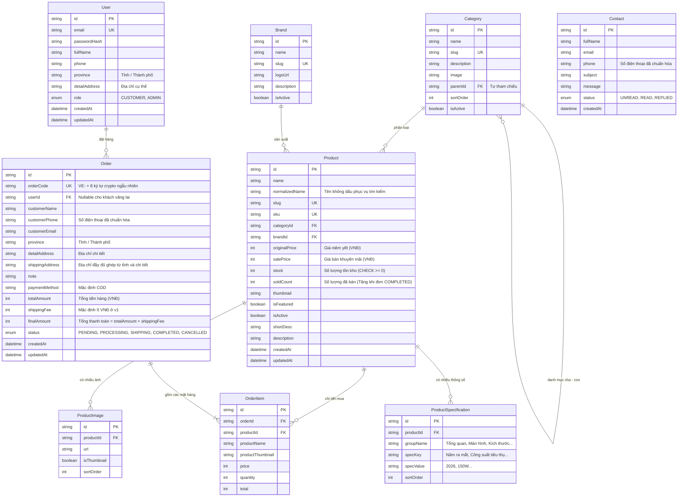

# THIẾT KẾ CƠ SỞ DỮ LIỆU (DATABASE SPECIFICATION)

## Dự án: Website Điện Máy VietElectro

Hệ thống sử dụng **PostgreSQL (v15+)** kết hợp với **Prisma ORM**.

---

## 1. Sơ đồ Thực thể - Mối quan hệ (ERD)



---

## 2. Chi tiết Lược đồ Prisma (`schema.prisma`)

```prisma
datasource db {
  provider = "postgresql"
  url      = env("DATABASE_URL")
}

generator client {
  provider = "prisma-client-js"
}

enum Role {
  CUSTOMER
  ADMIN
}

enum OrderStatus {
  PENDING     // Đơn hàng mới
  PROCESSING  // Đang xử lý / Đã gọi xác nhận
  SHIPPING    // Đang giao hàng
  COMPLETED   // Giao thành công / Hoàn tất (tăng soldCount)
  CANCELLED   // Đã hủy (hoàn tồn kho đúng 1 lần)
}

enum ContactStatus {
  UNREAD
  READ
  REPLIED
}

model User {
  id            String   @id @default(uuid())
  email         String   @unique
  passwordHash  String
  fullName      String
  phone         String?
  province      String?  // Tỉnh/Thành phố
  detailAddress String?  // Địa chỉ cụ thể: Số nhà, tên đường, phường/xã
  role          Role     @default(CUSTOMER)
  createdAt     DateTime @default(now())
  updatedAt     DateTime @updatedAt

  orders        Order[]

  @@index([email])
}

model Category {
  id          String     @id @default(uuid())
  name        String
  slug        String     @unique
  description String?
  image       String?
  parentId    String?
  sortOrder   Int        @default(0)
  isActive    Boolean    @default(true)
  createdAt   DateTime   @default(now())
  updatedAt   DateTime   @updatedAt

  parent      Category?  @relation("CategoryParentChild", fields: [parentId], references: [id], onDelete: SetNull)
  children    Category[] @relation("CategoryParentChild")
  products    Product[]

  @@index([slug])
  @@index([parentId])
}

model Brand {
  id          String    @id @default(uuid())
  name        String
  slug        String    @unique
  logoUrl     String?
  description String?
  isActive    Boolean   @default(true)
  createdAt   DateTime  @default(now())
  updatedAt   DateTime  @updatedAt

  products    Product[]

  @@index([slug])
}

model Product {
  id             String                 @id @default(uuid())
  name           String
  normalizedName String                 // Tên không dấu, chữ thường phục vụ tìm kiếm mượt mà
  slug           String                 @unique
  sku            String                 @unique
  categoryId     String
  brandId        String
  originalPrice  Int                    // Giá niêm yết (VNĐ)
  salePrice      Int                    // Giá bán thực tế (VNĐ)
  stock          Int                    @default(0) // Số lượng trong kho (Ràng buộc CHECK >= 0)
  soldCount      Int                    @default(0) // Số lượng đã bán (phục vụ lọc "Bán chạy")
  thumbnail      String?
  isFeatured     Boolean                @default(false)
  isActive       Boolean                @default(true) // Khi xóa sản phẩm đã có đơn -> chuyển thành false
  shortDesc      String?                @db.Text
  description    String?                @db.Text
  createdAt      DateTime               @default(now())
  updatedAt      DateTime               @updatedAt

  category       Category               @relation(fields: [categoryId], references: [id])
  brand          Brand                  @relation(fields: [brandId], references: [id])
  images         ProductImage[]
  specs          ProductSpecification[]
  orderItems     OrderItem[]

  @@index([slug])
  @@index([sku])
  @@index([categoryId])
  @@index([brandId])
  @@index([salePrice])
  @@index([stock])
  @@index([soldCount])
  @@index([normalizedName])
}

model ProductImage {
  id          String   @id @default(uuid())
  productId   String
  url         String
  isThumbnail Boolean  @default(false)
  sortOrder   Int      @default(0)
  createdAt   DateTime @default(now())

  product     Product  @relation(fields: [productId], references: [id], onDelete: Cascade)

  @@index([productId])
}

model ProductSpecification {
  id        String  @id @default(uuid())
  productId String
  groupName String  // Nhóm thông số: "Tổng quan", "Công nghệ hình ảnh", "Kích thước & Khối lượng"
  specKey   String  // Tên thông số: "Năm ra mắt", "Công suất tiêu thụ", "Nơi sản xuất"
  specValue String  // Giá trị: "2026", "180 W", "Thái Lan"
  sortOrder Int     @default(0)

  product   Product @relation(fields: [productId], references: [id], onDelete: Cascade)

  @@index([productId])
  @@index([groupName])
}

model Order {
  id              String      @id @default(uuid())
  orderCode       String      @unique // Định dạng: VE- + 8 ký tự crypto ngẫu nhiên
  userId          String?
  customerName    String
  customerPhone   String      // Số điện thoại sau khi chuẩn hóa
  customerEmail   String?
  province        String      // Tỉnh / Thành phố
  detailAddress   String      // Địa chỉ cụ thể
  shippingAddress String      // Địa chỉ giao hàng đầy đủ
  note            String?
  paymentMethod   String      @default("COD") // Thanh toán khi nhận hàng
  totalAmount     Int         // Tổng tiền hàng (VNĐ) - Kiểu Int32 (max ~2.14 tỷ), validation chặn <= 2 tỷ chống tràn số
  shippingFee     Int         @default(0)     // Quy tắc v1: Mặc định 0 VNĐ
  finalAmount     Int         // Tổng thanh toán = totalAmount + shippingFee (<= 2 tỷ VNĐ)
  status          OrderStatus @default(PENDING)
  createdAt       DateTime    @default(now())
  updatedAt       DateTime    @updatedAt

  user            User?       @relation(fields: [userId], references: [id], onDelete: SetNull)
  items           OrderItem[]

  @@index([orderCode])
  @@index([customerPhone])
  @@index([userId])
  @@index([status])
}

model OrderItem {
  id               String  @id @default(uuid())
  orderId          String
  productId        String
  productName      String  // Lưu bản sao tên sản phẩm tại thời điểm mua
  productThumbnail String?
  price            Int     // Đơn giá tại thời điểm mua (VNĐ)
  quantity         Int     // Số lượng mua
  total            Int     // Thành tiền = price * quantity

  order            Order   @relation(fields: [orderId], references: [id], onDelete: Cascade)
  product          Product @relation(fields: [productId], references: [id], onDelete: Restrict)

  @@index([orderId])
  @@index([productId])
}

model Contact {
  id        String        @id @default(uuid())
  fullName  String
  email     String?
  phone     String
  subject   String?
  message   String        @db.Text
  status    ContactStatus @default(UNREAD)
  createdAt DateTime      @default(now())
  updatedAt DateTime      @updatedAt

  @@index([status])
}
```

---

## 3. Ràng buộc Toàn vẹn Dữ liệu & Quy trình Migration Thủ công

Do Prisma ORM chưa hỗ trợ cú pháp `CHECK` constraint trực tiếp trong file `schema.prisma`, toàn bộ các ràng buộc nghiệp vụ ở tầng CSDL sẽ được thiết lập bằng SQL thủ công thông qua quy trình migration chuẩn:

### Quy trình 3 bước thực hiện:

1. **Bước 1**: Tạo file migration rỗng (chưa áp dụng vào CSDL):
   ```bash
   npx prisma migrate dev --create-only --name add_custom_check_constraints
   ```
2. **Bước 2**: Mở file `prisma/migrations/<timestamp>_add_custom_check_constraints/migration.sql` vừa sinh ra, bổ sung các câu lệnh SQL ở cuối file:
   ```sql
   -- 1. Ràng buộc tồn kho không bao giờ được âm (Chống over-selling ở tầng CSDL)
   ALTER TABLE "Product" ADD CONSTRAINT "chk_product_stock_non_negative" CHECK (stock >= 0);

   -- 2. Ràng buộc số lượng đã bán không âm
   ALTER TABLE "Product" ADD CONSTRAINT "chk_product_sold_count_non_negative" CHECK ("soldCount" >= 0);

   -- 3. Ràng buộc giá bán và giá niêm yết không âm
   ALTER TABLE "Product" ADD CONSTRAINT "chk_product_prices_valid" CHECK ("salePrice" >= 0 AND "originalPrice" >= 0);

   -- 4. Ràng buộc số lượng đặt trong OrderItem phải lớn hơn 0
   ALTER TABLE "OrderItem" ADD CONSTRAINT "chk_order_item_quantity_positive" CHECK (quantity > 0);
   ```
3. **Bước 3**: Áp dụng migration vào CSDL:
   ```bash
   npx prisma migrate dev
   ```
   Lệnh này thực thi các câu lệnh SQL trên PostgreSQL và tự động ghi nhận vào bảng quản lý `_prisma_migrations`.

---

## 4. Chính sách Xóa Sản phẩm (Bắt lỗi Khóa ngoại & Fallback Tự động sang Ẩn)

Khi Quản trị viên thực hiện yêu cầu xóa sản phẩm (`DELETE /api/v1/products/:id`):
Hệ thống không kiểm tra `count` trước để tránh race condition, mà thực hiện lệnh xóa cứng trực tiếp và bắt lỗi vi phạm ràng buộc khóa ngoại (Foreign Key Restrict từ `OrderItem`).

### Nguyên tắc Kỹ thuật Bắt buộc:

1. **Hai thao tác độc lập, KHÔNG nằm chung Transaction**: Trong PostgreSQL, khi một câu lệnh gặp lỗi (vi phạm ràng buộc khóa ngoại), PostgreSQL sẽ hủy toàn bộ transaction (`transaction is aborted, commands ignored until end of transaction block`). Mọi câu lệnh tiếp theo trong block đó (kể cả `UPDATE`) đều sẽ bị từ chối. Vì vậy, **lệnh xóa cứng và lệnh fallback chuyển sang ẩn bắt buộc phải là 2 thao tác CSDL độc lập hoàn toàn, không bọc chung trong `prisma.$transaction`**.
2. **Test tích hợp trên PostgreSQL thật là Nguồn sự thật**: Hệ thống không võ đoán hay phỏng đoán mã lỗi mà sử dụng Integration Test chạy trên **PostgreSQL thật** thử xóa sản phẩm có đơn hàng để xác nhận mã lỗi chính xác do Prisma Client / PostgreSQL driver ném ra (mã `P2003`), sau đó bắt lỗi đúng theo mã này.
3. **Xóa file storage chỉ sau khi DB đã xóa xong; lỗi chỉ ghi log**: Chỉ khi lệnh xóa cứng bản ghi trong CSDL đã hoàn tất thành công, server mới tiến hành xóa file ảnh vật lý trên storage (thư mục `server/uploads/` hoặc Cloudflare R2 / S3). Nếu việc xóa file vật lý thất bại (do mạng/storage), **chỉ ghi log lỗi (`logger.error`) chứ tuyệt đối không ném lỗi (không throw error)** làm ảnh hưởng đến response thành công của API.
4. **Cấu trúc Response chuẩn**: Luôn tuân thủ định dạng `{ success, data, message }`, đặt `isArchived` bên trong `data`.

```typescript
import { Prisma } from '@prisma/client';
import { prisma } from '../config/db';
import { deleteStorageFiles } from '../utils/storage';
import { logger } from '../utils/logger';

export async function deleteProductService(productId: string) {
  // 1. Đọc trước danh sách URL ảnh để chuẩn bị dọn dẹp nếu xóa cứng thành công
  const productImages = await prisma.productImage.findMany({
    where: { productId },
    select: { url: true },
  });

  try {
    // 2. Thao tác ĐỘC LẬP 1: Thử xóa cứng sản phẩm trực tiếp (không nằm trong transaction chung với fallback)
    await prisma.product.delete({
      where: { id: productId },
    });

    // 3. Xóa cứng DB thành công -> Tiến hành xóa các file ảnh vật lý trên storage
    if (productImages.length > 0) {
      try {
        await deleteStorageFiles(productImages.map((img) => img.url));
      } catch (fileErr) {
        // Lỗi xóa file vật lý chỉ ghi log cảnh báo, không throw error làm gián đoạn response thành công
        logger.error(`Lỗi dọn dẹp file ảnh storage cho sản phẩm ${productId}:`, fileErr);
      }
    }

    return {
      success: true,
      data: { isArchived: false },
      message: 'Đã xóa vĩnh viễn sản phẩm và dọn dẹp các tệp ảnh liên quan thành công.',
    };
  } catch (error) {
    // 4. Bắt lỗi vi phạm ràng buộc khóa ngoại (Xác nhận từ integration test trên Postgres thật là nguồn sự thật)
    if (error instanceof Prisma.PrismaClientKnownRequestError && error.code === 'P2003') {
      // Thao tác ĐỘC LẬP 2: Fallback cập nhật sản phẩm sang trạng thái Ẩn
      await prisma.product.update({
        where: { id: productId },
        data: { isActive: false },
      });

      return {
        success: true,
        data: { isArchived: true },
        message:
          'Sản phẩm đã có đơn hàng trong quá khứ nên không thể xóa vĩnh viễn; hệ thống đã tự động chuyển sang trạng thái Ẩn.',
      };
    }

    throw error;
  }
}
```

---

## 5. Ma trận Phân quyền Truy cập Dữ liệu (Access Control Matrix)

| Bảng dữ liệu               | Khách vãng lai (Guest)                                                          | Khách đã đăng nhập (Customer)                     | Quản trị viên (Admin)                                             | Ghi chú bảo mật                                                                                                   |
| :------------------------- | :------------------------------------------------------------------------------ | :------------------------------------------------ | :---------------------------------------------------------------- | :---------------------------------------------------------------------------------------------------------------- |
| **`User`**                 | Không có quyền                                                                  | Xem/Sửa thông tin của chính mình                  | Xem danh sách tất cả tài khoản                                    | Mật khẩu băm bằng Argon2, tuyệt đối không trả về `passwordHash`. Bỏ qua mọi trường `role` client gửi khi đăng ký. |
| **`Category`**             | Chỉ xem (`isActive=true`)                                                       | Chỉ xem                                           | Toàn quyền (Tạo/Sửa/Xóa/Đổi thứ tự)                               | Chặn xóa nếu còn sản phẩm trực thuộc.                                                                             |
| **`Brand`**                | Chỉ xem (`isActive=true`)                                                       | Chỉ xem                                           | Toàn quyền (Tạo/Sửa/Xóa)                                          | Chặn xóa nếu còn sản phẩm mang thương hiệu này.                                                                   |
| **`Product`**              | Chỉ xem sản phẩm kích hoạt (`isActive=true`)                                    | Chỉ xem sản phẩm kích hoạt                        | Toàn quyền (Thêm/Sửa/Ẩn/Xóa)                                      | Tìm kiếm qua `normalizedName`. Không xóa cứng sản phẩm đã có đơn. Sắp xếp bán chạy qua `soldCount`.               |
| **`ProductImage`**         | Chỉ xem ảnh theo sản phẩm                                                       | Chỉ xem ảnh theo sản phẩm                         | Toàn quyền (Upload/Xóa/Đặt ảnh đại diện)                          | Ảnh upload luôn re-encode WebP, xóa file gốc, kiểm tra pixel < 16MP.                                              |
| **`ProductSpecification`** | Chỉ xem thông số kỹ thuật                                                       | Chỉ xem thông số kỹ thuật                         | Toàn quyền (Thêm/Sửa/Xóa theo nhóm)                               | Dữ liệu cấu trúc bảng phân nhóm.                                                                                  |
| **`Order`**                | Tạo đơn mới (COD); Tra cứu **chỉ đúng đơn của mình** bằng Mã đơn + SĐT qua POST | Tạo đơn mới; Xem danh sách đơn của tài khoản mình | Toàn quyền xem tất cả đơn, cập nhật trạng thái theo State Machine | Tra cứu public qua POST `/api/v1/orders/lookup`. Hoàn kho đúng 1 lần khi hủy đơn.                                 |
| **`OrderItem`**            | Xem các món trong đơn tra cứu hợp lệ                                            | Xem các món trong đơn của mình                    | Toàn quyền xem                                                    | Khóa dữ liệu (`Restrict`) khi sản phẩm đã phát sinh đơn.                                                          |
| **`Contact`**              | Tạo mới (Gửi phản hồi)                                                          | Tạo mới (Gửi phản hồi)                            | Xem danh sách, cập nhật trạng thái đã đọc/trả lời                 | Áp dụng Rate Limit chống spam.                                                                                    |
